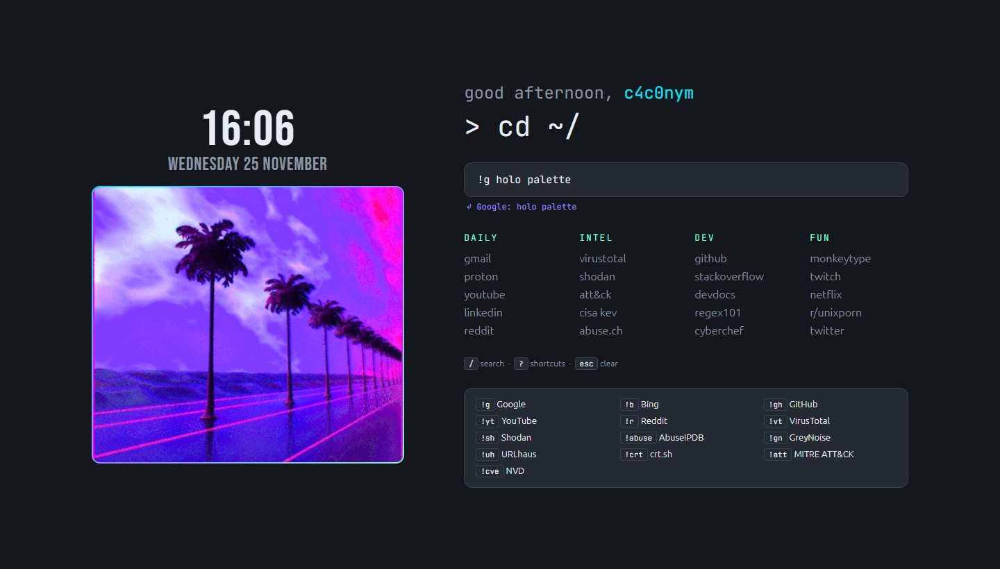

# startpage

A minimal, keyboard-friendly browser start page: clock, quick search with lookup shortcuts, and
bookmarks, next to a retro gif you can click to switch.

**Live:** https://c4c0nym.github.io/

## Features

- **Clock and greeting** that follow your local time, on a 24-hour clock.
- **Search box.** Press <kbd>/</kbd> from anywhere to focus it. Plain text goes to DuckDuckGo,
  and anything that looks like an address (`github.com/c4c0nym`) is opened directly.
- **Shortcuts and bangs:** type a prefix and then your query, with or without a `!`, before or after the text: `g cats`, `!g cats` and `cats !g` all search Google. Press <kbd>?</kbd> on the page for the full list. Bangs that are not in the list (`!w`, `!a`, ...) are passed on to DuckDuckGo, which supports thousands.

  | Prefix | Goes to | Example |
  |---|---|---|
  | `vt` | VirusTotal | `vt 44d88612fea8a8f36de82e1278abb02f` |
  | `sh` | Shodan | `sh apache country:NL` |
  | `abuse` | AbuseIPDB | `abuse 185.220.101.1` |
  | `gn` | GreyNoise | `gn 1.2.3.4` |
  | `uh` | URLhaus | `uh evil.example` |
  | `crt` | crt.sh (certificate transparency) | `crt %.example.com` |
  | `att` | MITRE ATT&CK technique | `att T1059` |
  | `cve` | NVD | `cve CVE-2024-3400` |
  | `g` / `b` | Google / Bing | `!g cats`, `!b weather` |
  | `gh` / `yt` / `r` | GitHub / YouTube / Reddit | `gh iocscope` |

- **Pictures:** click the gif to cycle through the ones in this repo. Your choice is remembered.
- **Responsive.** It works on narrow windows and respects "reduce motion".

## Use it

Either set **https://c4c0nym.github.io/** as your home or new-tab page, or run it
locally:

1. `git clone https://github.com/c4c0nym/c4c0nym.github.io`
2. Set the full path to `index.html` (e.g. `file:///C:/startpage/index.html`) as your browser's start page.

## Customize

Everything lives in **`config.js`**:

- `bookmarks`: columns of `["label", "url"]` pairs.
- `shortcuts`: search prefixes. `%s` is replaced by what you type.
- `gifs`: the pictures to cycle through. Drop your own file in the folder and add it here.
- `search`: the default search engine.

Colours are CSS variables at the top of `style.css` (the Holo palette: graphite, gunmetal and steel, with cyan, violet and mint accents).

## Credits

Originally based on [kencx/startpage](https://github.com/kencx/startpage), via
[nwvh](https://github.com/nwvh/). The gifs are by their respective artists.
