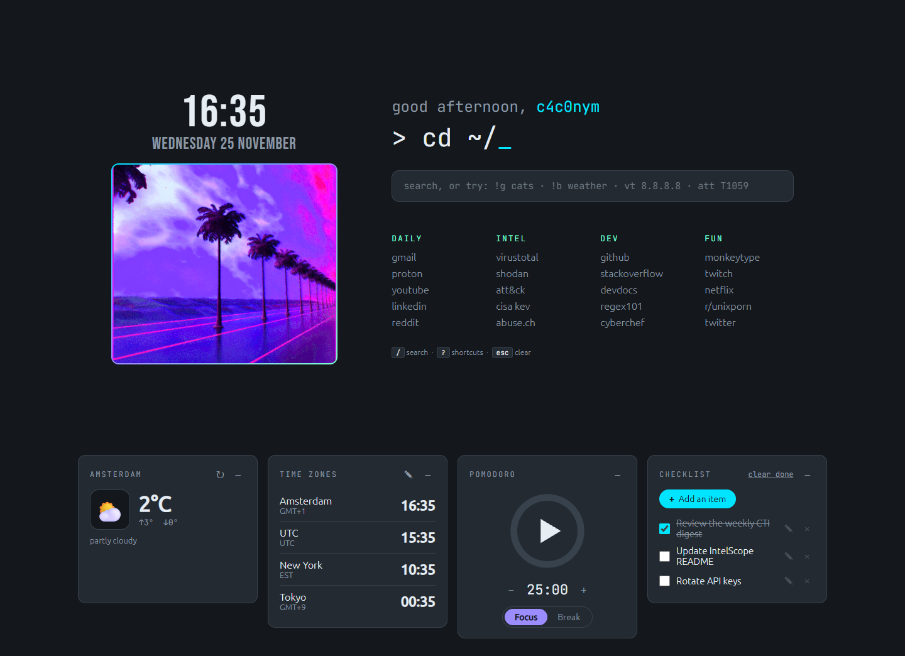

# startpage

A minimal, keyboard-friendly browser start page: clock, quick search with lookup shortcuts, and
bookmarks, next to a retro gif you can click to switch.

The widgets start minimized. Opened up:

**Live:** https://c4c0nym.github.io/

## Features

- **Clock and greeting** that follow your local time, on a 24-hour clock.
- **Search box.** Press <kbd>/</kbd> from anywhere to focus it. Plain text goes to DuckDuckGo,
  and anything that looks like an address (`github.com/c4c0nym`) is opened directly.
- **Shortcuts and bangs:** type a prefix and then your query, with or without a `!`, before or after the text: `g cats`, `!g cats` and `cats !g` all search Google. Press <kbd>?</kbd> on the page for the full list. The menu also lists a set of DuckDuckGo bangs (`!w` Wikipedia, `!a` Amazon, `!so` Stack Overflow, ...). Any other bang is passed on to DuckDuckGo too, which supports thousands. Edit `ddgBangs` in `config.js` to change the list.

  | Prefix | Goes to | Example |
  |---|---|---|
  | `vt` | VirusTotal | `vt 44d88612fea8a8f36de82e1278abb02f` |
  | `sh` | Shodan | `sh apache country:NL` |
  | `abuse` | AbuseIPDB | `abuse 185.220.101.1` |
  | `gn` | GreyNoise | `gn 1.2.3.4` |
  | `uh` | URLhaus | `uh evil.example` |
  | `crt` | crt.sh (certificate transparency) | `crt %.example.com` |
  | `att` | MITRE ATT&CK technique | `att T1059` |
  | `cve` | NVD | `cve CVE-2024-3400` |
  | `g` / `b` | Google / Bing | `!g cats`, `!b weather` |
  | `gh` / `yt` / `r` | GitHub / YouTube / Reddit | `gh iocscope` |

- **Your name:** click the name after the greeting to change it. It is saved in your browser; clear the field to go back to the default from `config.js`.
- **Widgets** under the search box. They start minimized as a slim bar with one line each (temperature and place, the first time zone, the timer, open checklist items). Click a bar to open the widget, click **–** in its header to fold it again; the choice is remembered per widget:
  - **Weather** for where you are. It asks for your location only when you click **Use my location** (or when the browser already allows it), and falls back to a city search if you decline.
  - **Time zones:** up to four, 24-hour times with the zone offset. Use ✎ to add or remove them; type a city (`Tokyo`) or a zone (`Europe/Paris`).
  - **Pomodoro timer:** focus and break modes, − / + to change the length, a ring that fills as time passes, a short beep at the end and the countdown in the tab title.
  - **Checklist:** add, tick, edit (✎ or double-click) and delete items. Everything is stored in your browser only.
- **Pictures:** click the gif to cycle through the ones in this repo. Your choice is remembered.
- **Responsive.** It works on narrow windows and respects "reduce motion".

## Privacy

The page has no backend and no tracking. Checklist items, time zones and timer lengths stay in your
browser's `localStorage`. The weather widget is the one part that talks to other services, only
after you allow it to locate you: your coordinates, rounded to about 1 km, go to
[Open-Meteo](https://open-meteo.com/) for the forecast and to
[BigDataCloud](https://www.bigdatacloud.com/) to turn them into a place name. A typed city goes to
Open-Meteo's geocoder. Nothing is sent before that, and the last result is cached locally for 15 minutes.

## Use it

Either set **https://c4c0nym.github.io/** as your home or new-tab page, or run it
locally:

1. `git clone https://github.com/c4c0nym/c4c0nym.github.io`
2. Set the full path to `index.html` (e.g. `file:///C:/startpage/index.html`) as your browser's start page.

## Customize

Everything lives in **`config.js`**:

- `bookmarks`: columns of `["label", "url"]` pairs.
- `shortcuts`: search prefixes. `%s` is replaced by what you type.
- `gifs`: the pictures to cycle through. Drop your own file in the folder and add it here.
- `search`: the default search engine.
- `widgets`: temperature unit, default time zones (up to four) and timer lengths. Changes you make on the page are saved in your browser and take precedence.

Colours are CSS variables at the top of `style.css` (the Holo palette: graphite, gunmetal and steel, with cyan, violet and mint accents).

## Credits

Originally based on [kencx/startpage](https://github.com/kencx/startpage), via
[nwvh](https://github.com/nwvh/). The gifs are by their respective artists.
